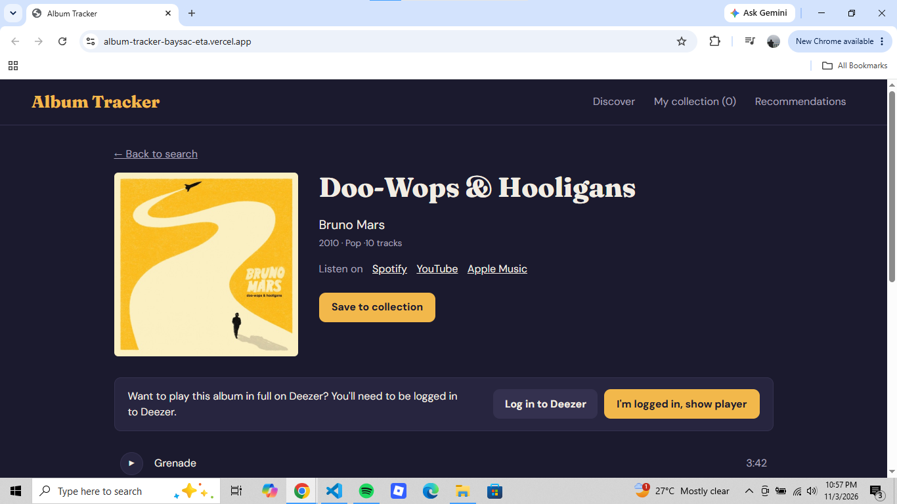

# ALBUM TRACKER

This app lets you search for a music albums, preview their tracks or play a short 30 seconds part of it. This is a music discovery and collection management web application designed for exploring and organizing music.

## Link
[Vercel Link](https://album-tracker-baysac-eta.vercel.app/): https://album-tracker-baysac-eta.vercel.app/

## Screenshots
#### Landing Page

#### Search

#### Play

#### Save to collection

#### Collection

#### Recommendations

## Tech stack 
- React
- Vite
- Context API
- iTunes API
- Deezer
- Gemini
- Vercel

## Run Locally
How to run it locally (clone, npm install , create .env.local , npm run dev )

## Limitations
Limitations (30-second previews, collection saved only in your browser, Deezer needs a login for full tracks)

## Privacy Note
A privacy note about the AI feature and a disclaimer that the project is not affiliated
with Apple, Spotify, Deezer, or Google