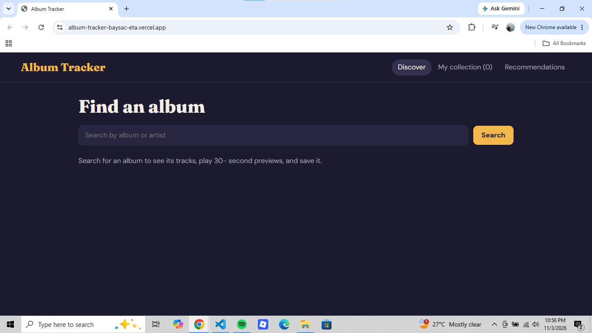
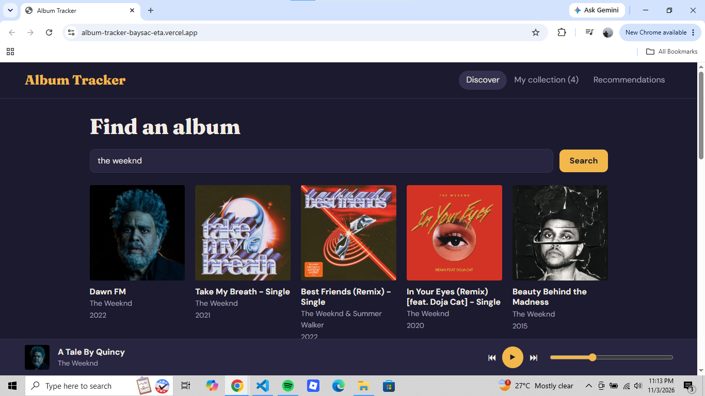
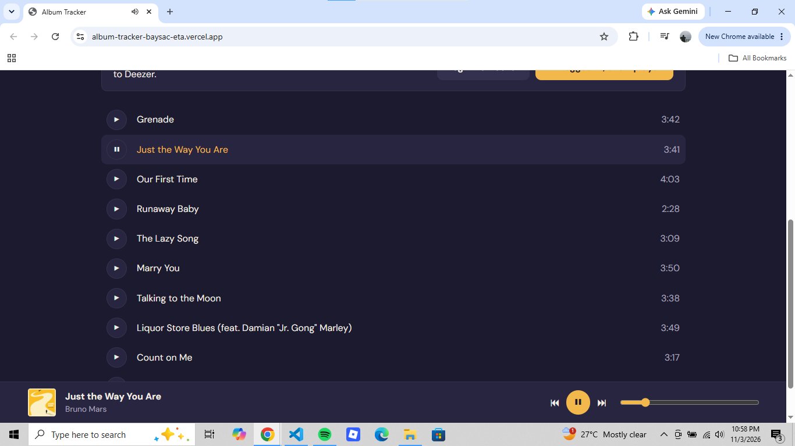
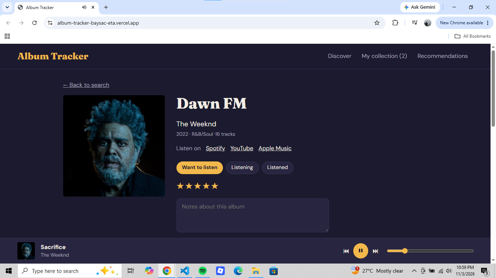
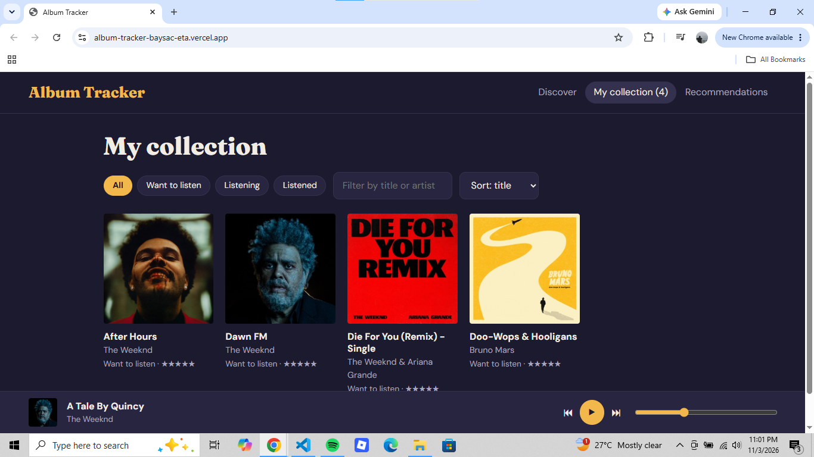
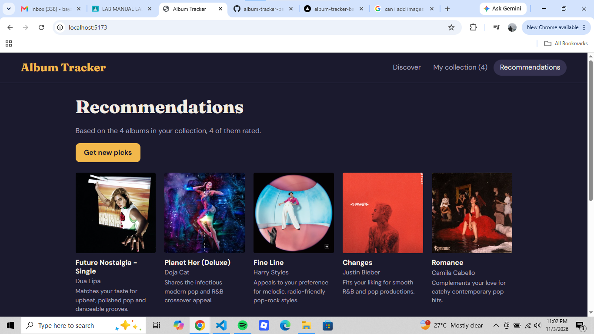

# ALBUM TRACKER

This app lets you search for a music albums, preview their tracks or play a short 30 seconds part of it. This is a music discovery and collection management web application designed for exploring and organizing music.

## Link
[Vercel Link](https://album-tracker-baysac-eta.vercel.app/): https://album-tracker-baysac-eta.vercel.app/

## Screenshots
#### Landing Page

#### Search

#### Play

#### Save to collection

#### Collection

#### Recommendations

## Tech stack 
- React
- Vite
- Context API
- iTunes API
- Deezer
- Gemini
- Vercel

## Run Locally
How to run it locally (clone, npm install , create .env.local , npm run dev )

## Limitations
Limitations (30-second previews, collection saved only in your browser, Deezer needs a login for full tracks)

## Privacy Note
A privacy note about the AI feature and a disclaimer that the project is not affiliated
with Apple, Spotify, Deezer, or Google

# Reflection Questions
1. Why is the audio element stored in a useRef instead of useState ?
    - So that the music will still be played or in the state of playing even if we move between pages to pages. Using the useRef will make the audio immune to rerenders unlike thr useState that can cause rerenders when we move around.

2. Why do all API calls live in services/ instead of inside components?
    - So that it is separated to the other, because components are for the parts of the ui like navigation bar. While the services like api calls are for the functions. Separating this two organizez all the files and make it easy to gets what and where are the files.

3. Why can the Gemini key not be placed in React code? What could happen if you pushed it to GitHub?
    - The Gemini API key is very sensitive, it is unique to every one person or user, other person having your key can lead into them getting some of your info, and can possibly hack your account.

4. Why is this recommender an LLM prompt and not a trained machine learning model? Give one strength and one weakness.
    - Using an existing LLM takes a lot of time and resources than training a machine from scratch, because it is really hard to do machine learning, if you use an existing LLM you can just talk to it and get the answer you need. But there is a weakness from using LLM, LLM can sometimes hallucinates or assume a data that are not existing.

5. Describe the hardest bug you hit and how you fixed it.
    - In my side I didnt encounter any bug, since I follow every step and I also analyze first what I will input so that I have less margin of error.